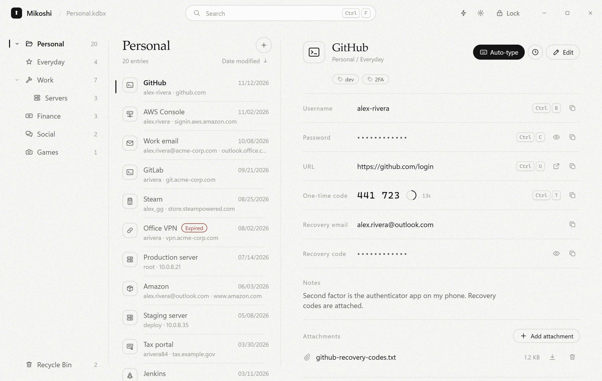
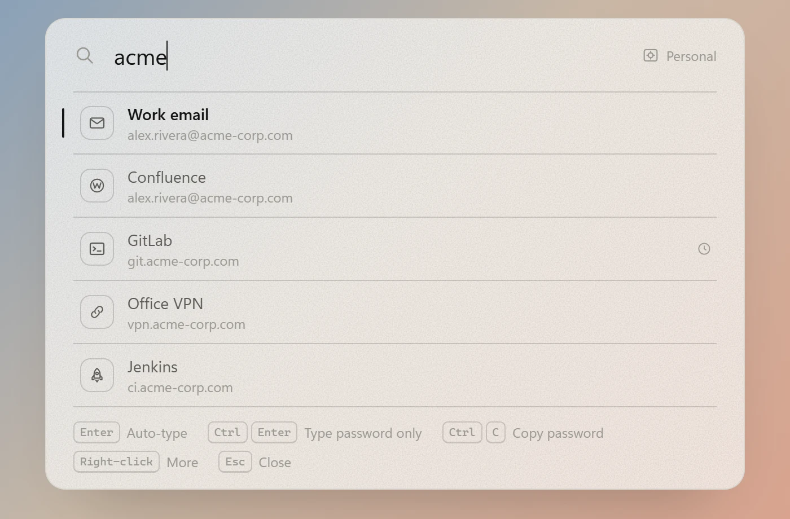
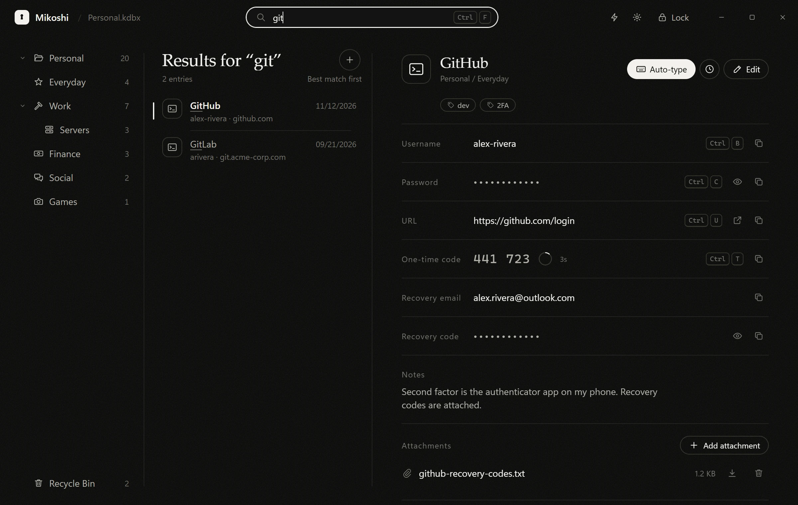
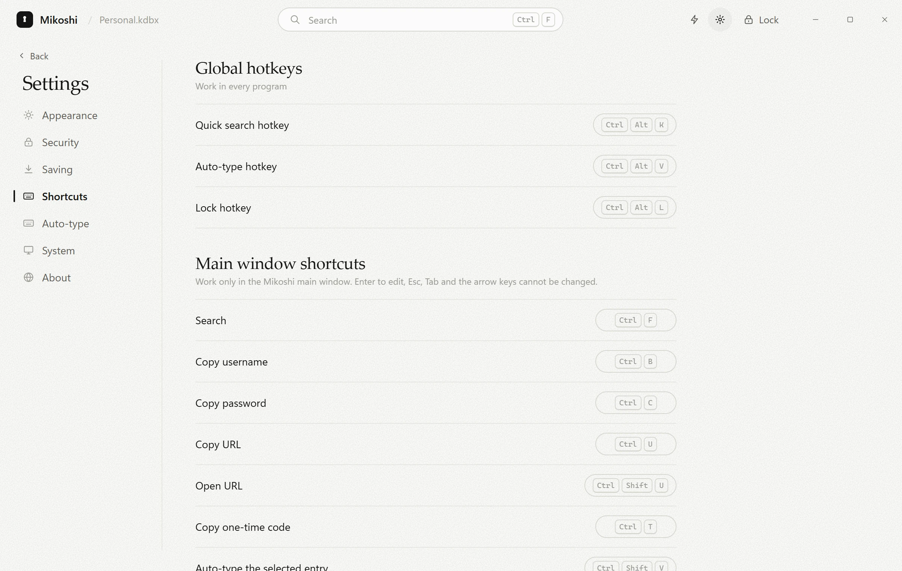

<p align="center">
  
</p>

<h1 align="center">Mikoshi</h1>

<p align="center">
  <b>A keyboard-first password manager for Windows that works directly with KeePass files.</b><br>
  Your <code>.kdbx</code> database, shared with KeePassXC, KeePass 2 and KeePassDX, in a quiet interface you can drive without the mouse.
</p>

<p align="center">
  <a href="https://github.com/ElmTran/mikoshi/releases"></a>
  
  <a href="#license"></a>
</p>

<p align="center">
  English · <a href="README.zh-CN.md">简体中文</a>
</p>



## Why Mikoshi

- **Your file, your rules.** Mikoshi reads and writes standard KeePass `.kdbx` files. There is no account, no cloud and no network access. Keep the file wherever you like and sync it however you like.
- **Plays well with other KeePass apps.** Use KeePassXC on another PC and KeePassDX on your phone, all with the same database. When Mikoshi saves, it rewrites only what you changed. Everything else, including data it does not understand, is written back exactly as it was.
- **Everything from the keyboard.** Press `Ctrl+Alt+K` in any program to search your vault. Press `Ctrl+Alt+V` on a login page and Mikoshi types your username and password for you.
- **Secrets stay in Rust.** Passwords, protected fields and one-time code secrets never reach the user interface unless you ask to see them. Copying, auto-type and code generation all happen in the Rust backend.
- **Calm by design.** A paper-and-ink look in light and dark themes, with no clutter.

## Screenshots

| Quick search, from any program | Dark theme |
|---|---|
|  |  |

| Every shortcut can be changed |
|---|
|  |

## Features

- Open KDBX 3.1, 4.0 and 4.1 databases with a master password, a key file, or both
- Browse groups and entries, with fuzzy search and field filters (`title:`, `user:`, `url:`, `tag:`)
- Copy usernames, passwords, URLs and one-time codes (TOTP). Copied secrets stay out of clipboard history and are cleared automatically
- Quick search box and auto-type, available from anywhere through global hotkeys
- Create and edit entries, with custom and protected fields, tags, expiry dates, icons and attachments
- Entry history with restore, a recycle bin, and group management with drag and drop
- Password generator for random passwords and passphrases (EFF word list), with a strength estimate
- Saves every change immediately with a safe write and a backup, and warns you when the file was changed somewhere else
- Locks automatically when idle, when Windows locks, or when the computer sleeps. Lives in the system tray
- Light and dark themes; English and Simplified Chinese

## Download and install

Mikoshi is in **beta** (0.9.x pre-releases). It is already in daily use, but please keep a backup of your database.

1. Download `Mikoshi_x.y.z_x64-setup.exe` from [Releases](https://github.com/ElmTran/mikoshi/releases) and run it.
2. It installs for the current user only, into `%LOCALAPPDATA%\Programs\Mikoshi`, and needs no administrator rights. You can choose a different folder in the installer.
3. The installer is not code-signed, so Windows SmartScreen will warn about an "unrecognized app" the first time. Click **More info** → **Run anyway**. You only need to do this once.
4. Mikoshi uses Microsoft WebView2, which comes with Windows 11 and up-to-date Windows 10. If it is missing, the installer downloads it from Microsoft. That is the only network access, and it happens during setup only. Mikoshi itself never goes online.

To uninstall, go to Windows Settings → Apps → Mikoshi → Uninstall. Settings are kept in `%APPDATA%\com.elmtran.mikoshi\`; delete that folder if you want to remove them too. It contains no passwords.

## Getting started

- **Open an existing database.** Pick a `.kdbx` file and enter the master password. If the database uses a key file, choose **Add a key file**. Mikoshi remembers recent databases and the key file used for each one (paths only).
- **Create a new database.** Choose **New database…** on the unlock screen. Set a master password, and optionally add a key file (an existing one or a newly generated one). New databases use KDBX 4.1, AES-256 and Argon2id, tuned so that unlocking takes about one second on your computer.
- KeePass 1 `.kdb` files are not supported.

## Everyday use

- **Search.** Press `Ctrl+F` or start typing in the search box at the top. Every word must match. Use `title:`, `user:`, `url:` and `tag:` to limit a word to one field, and quotes to include spaces (`title:"my bank"`). Partial typing works too: `gthb` finds GitHub.
- **Copy.** With an entry selected, `Ctrl+B` copies the username, `Ctrl+C` the password, `Ctrl+T` the one-time code and `Ctrl+U` the URL. Passwords and codes are kept out of clipboard history (`Win+V`) and cloud clipboard, and are cleared after 10 seconds by default. If you copied something else in the meantime, it is left alone.
- **Quick search box.** Press `Ctrl+Alt+K` anywhere. Type a few letters, then press `Enter` to auto-type, `Ctrl+Enter` to type just the password, `Ctrl+C` to copy the password, `Ctrl+B` to copy the username, `Ctrl+T` to copy the one-time code, or `Esc` to close. Right-click an entry for more.
- **Auto-type.** On a login page, press `Ctrl+Alt+V`. Mikoshi finds the matching entry from the window title and the URL in the browser's address bar, then types "username, Tab, password, Enter". Each entry can have its own sequence and window rules, using the KeePass placeholder syntax. If several entries match, you pick one; if none do, the quick search box opens. If the target window runs as administrator, Windows blocks typed input, and Mikoshi tells you so.
- **Auto-lock.** Mikoshi locks after a period of inactivity (5 minutes by default), when you lock Windows (`Win+L`), and when the computer goes to sleep. Lock it by hand with `Ctrl+L` or `Ctrl+Alt+L`. Locking discards everything that was decrypted in memory.
- **Tray.** Closing the main window only hides it. Mikoshi keeps running in the tray, so the global hotkeys keep working. To quit, use the tray menu.

## Editing and saving

- `Ctrl+N` creates an entry; `Ctrl+E` or `Enter` edits one. You can edit the standard fields, tags, expiry date, custom fields (each can be protected), the one-time code (paste an `otpauth://` link or enter the secret), the icon, and the auto-type settings.
- Before every change, the old version goes into the entry's history, up to the limit set in the database. You can view and restore any earlier version.
- `Delete` moves an entry or group to the recycle bin. Deleting from the recycle bin removes it for good, after a confirmation. The recycle bin can be emptied.
- Groups can be created, renamed, moved and deleted. Drag entries and groups to move them.
- Attachments can be added, saved to disk and removed.
- **Password generator.** Press `Ctrl+G`, or click the key button next to the password field while editing. Choose the length and character sets, leave out look-alike characters, or generate a passphrase from English words. A strength estimate is shown.
- **Saving.** By default every change is written to the file right away. Mikoshi writes to a temporary file, checks it, and only then replaces the database, keeping the previous version as `name.kdbx.bak` (this can be turned off). If you prefer, turn off **Save every change at once** in Settings and save with `Ctrl+S`; the title bar then shows when there are unsaved changes.
- **File changed elsewhere** (for example, just synced, or open in KeePassXC at the same time). Mikoshi asks before saving: reload (dropping your changes), overwrite, or cancel. If this happens while locking, your changes are saved as `name.mikoshi-conflict-time.kdbx`, so nothing is lost on either side.

## Keyboard shortcuts

All of them can be changed in Settings.

**Global** (work in every program)

| Action | Default |
|---|---|
| Quick search box | `Ctrl+Alt+K` |
| Auto-type | `Ctrl+Alt+V` |
| Lock | `Ctrl+Alt+L` |

**Main window**

| Action | Default |
|---|---|
| Search | `Ctrl+F` |
| Copy username | `Ctrl+B` |
| Copy password | `Ctrl+C` |
| Copy URL | `Ctrl+U` |
| Open URL | `Ctrl+Shift+U` |
| Copy one-time code | `Ctrl+T` |
| Auto-type the selected entry | `Ctrl+Shift+V` |
| Show or hide password | `Ctrl+H` |
| New entry | `Ctrl+N` |
| Edit entry | `Ctrl+E` or `Enter` |
| Delete | `Delete` |
| Save | `Ctrl+S` |
| Lock | `Ctrl+L` |
| Password generator | `Ctrl+G` |
| Settings | `Ctrl+,` |

The arrow keys, `Home`, `End`, `PageUp` and `PageDown` move between groups and entries; `Tab` moves between the three panes.

## Coming from KeePassXC or KeePass 2

- Nothing to import or export. Open your existing `.kdbx` file; the apps can take turns with the same file.
- **Mikoshi writes KDBX 4.1 only.** The first time you save a KDBX 3.1 or 4.0 database, Mikoshi asks first; after that the file is 4.1. KeePass 2.48 and later and KeePassXC 2.8 can open it; older versions cannot.
- The cipher, key derivation settings and compression are kept as they are. Mikoshi cannot change them or the master key yet (see the [Roadmap](#roadmap)); use KeePassXC for that for now.
- Saving rewrites only what you changed. Data written by other clients that Mikoshi does not understand is kept as it is.
- One-time codes: Mikoshi reads KeePassXC's `otp` field, KeePass 2's built-in `TimeOtp-*` fields and the older `TOTP Seed` format. If you change a code in Mikoshi, it is stored as an `otp` field.
- Permanent deletions are recorded in the database's list of deleted objects, so sync tools and other clients know the item was deleted on purpose.

## Security

- Passwords, protected fields and one-time code secrets stay in the Rust part of the program. The interface only receives things like titles and usernames, and copying, auto-type and code generation are done in Rust. A secret is sent to the interface only when you click **Show** or open the editor, and only for that one entry; it is discarded afterwards.
- Secrets in memory are wiped when they are released. Locking drops the whole decrypted database.
- Passwords and entry contents never appear in logs or error messages.
- No network access and no remote resources. Release builds have developer tools turned off and a strict Content Security Policy.
- Only one instance runs at a time; starting Mikoshi again brings the running window to the front.

## Roadmap

Planned for after 1.0:

- **Database settings:** change the master password and key file, and the cipher, key derivation and compression settings.
- **Several databases open at once:** for example, a personal and a work database side by side.

Not available today: browser extension, SSH agent, password breach checks, import and export, KeeShare, Windows Hello unlock, YubiKey, and macOS or Linux versions.

Ideas and bug reports are welcome in [Issues](https://github.com/ElmTran/mikoshi/issues).

## Building from source

Mikoshi is built with Tauri 2, React and TypeScript. The backend is Rust, and database files are read and written by its own lossless KDBX layer in `crates/kdbx`.

You need Rust 1.90 or later with the MSVC toolchain (Visual Studio Build Tools with "Desktop development with C++"), Node.js and pnpm.

```bash
pnpm install
pnpm tauri dev     # run the app
pnpm check         # types, ESLint, clippy, formatting and tests
pnpm tauri build   # build the NSIS installer
```

Developer documentation is in Chinese: the feature spec in [docs/features.md](docs/features.md), project structure and conventions in [docs/architecture.md](docs/architecture.md), and KDBX compatibility testing in [tests/fixtures/README.md](tests/fixtures/README.md).

## License

Mikoshi is released under the MIT License. The open-source components it uses and their licenses are listed in [THIRD-PARTY-NOTICES.txt](THIRD-PARTY-NOTICES.txt), which is also included in the install folder. The passphrase word list comes from the [EFF](https://www.eff.org/dice) and is licensed under CC BY 3.0 US.
