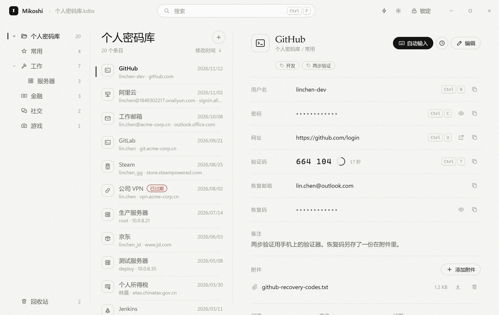
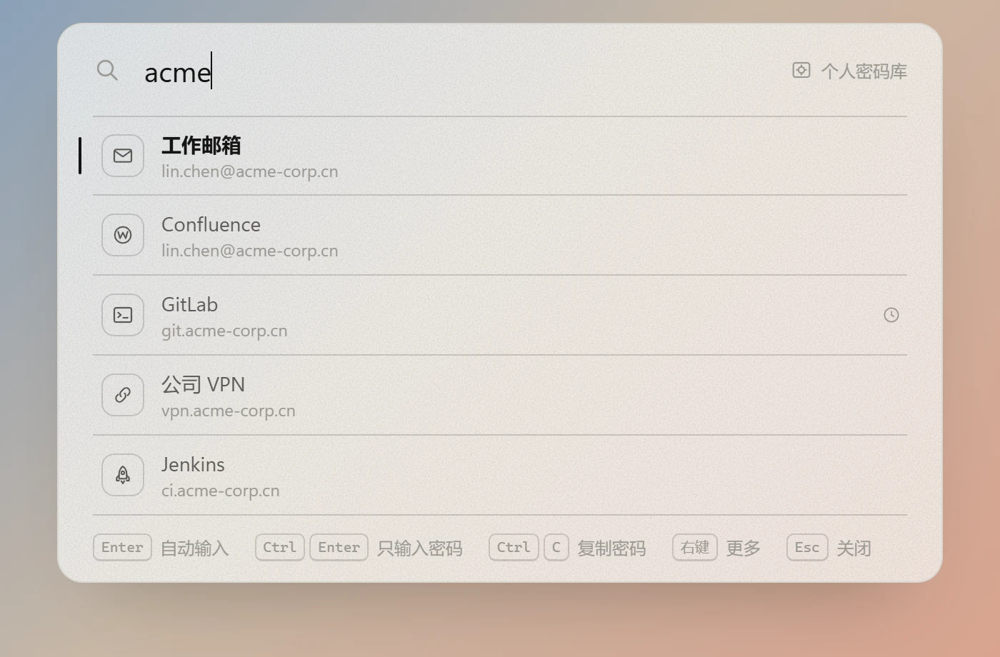
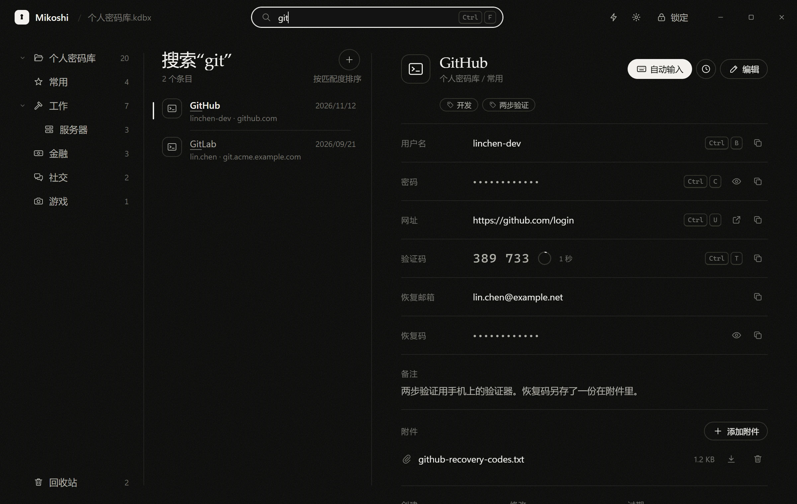
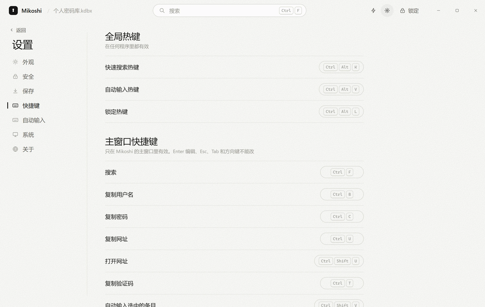

<p align="center">
  
</p>

<h1 align="center">Mikoshi</h1>

<p align="center">
  <b>Windows 上以快捷键为中心的密码管理器，直接读写 KeePass 密码库。</b><br>
  还是你原来的 <code>.kdbx</code> 文件，和 KeePassXC、KeePass 2、KeePassDX 一起用；界面安静，不碰鼠标也能用。
</p>

<p align="center">
  <a href="https://github.com/ElmTran/mikoshi/releases"></a>
  
  <a href="#许可证"></a>
</p>

<p align="center">
  <a href="README.md">English</a> · 简体中文
</p>



## 为什么用 Mikoshi

- **文件是你的**：读写标准的 KeePass `.kdbx` 文件。没有账号，没有云，不联网；文件放在哪里、怎么同步由你决定
- **和其他 KeePass 客户端相安无事**：另一台电脑用 KeePassXC、手机用 KeePassDX，都是同一个库。Mikoshi 保存时只改动过的地方，其余内容原样写回，连它不认识的数据也不会丢
- **全程键盘**：在任何程序里按 `Ctrl+Alt+K` 搜索密码库；在登录页按 `Ctrl+Alt+V`，Mikoshi 替你输入账号和密码
- **秘密只留在 Rust 端**：密码、受保护字段和验证码密钥不会交给界面，除非你主动要看；复制、自动输入、计算验证码都在 Rust 端完成
- **安静的界面**：纸墨风格，浅色深色各一套，没有多余的东西

## 截图

| 在任何程序里呼出快速搜索框 | 深色模式 |
|---|---|
|  |  |

| 每个快捷键都能改 |
|---|
|  |

## 功能

- 打开 KDBX 3.1、4.0、4.1 密码库，支持主密码、密钥文件或两者一起用
- 浏览分组和条目；模糊搜索，可以用 `title:`、`user:`、`url:`、`tag:` 只搜某个字段
- 复制用户名、密码、网址、验证码（TOTP）；复制的密码不进剪贴板历史，到时自动清掉
- 快速搜索框、自动输入和快速保存（一个热键存下当前网站的新密码），全局热键随叫随到
- 新建和编辑条目：自定义字段和受保护字段、标签、过期时间、图标、附件
- 历史版本可以恢复；回收站；分组管理，支持拖放
- 密码生成器：随机密码或口令短语（EFF 词表），显示强度估算
- 每次修改立即安全写入并留备份；文件被别处改过时会提示
- 修改主密码和密钥文件，更换加密算法和密钥派生参数
- 一段时间不用、锁屏、睡眠时自动锁定；常驻托盘
- 浅色和深色主题；简体中文和英文

## 下载安装

Mikoshi 现在是**测试版**（0.9.x 预发布）。作者自己已经天天在用，但请给你的密码库留好备份。

1. 到 [Releases](https://github.com/ElmTran/mikoshi/releases) 下载 `Mikoshi_x.y.z_x64-setup.exe`，运行它
2. 默认只给当前用户安装，装在 `%LOCALAPPDATA%\Programs\Mikoshi`，不需要管理员权限；安装向导里可以换目录
3. 安装包没有代码签名，第一次运行时 Windows SmartScreen 会提示"无法识别的应用"：点"更多信息"→"仍要运行"，以后不会再提示
4. Mikoshi 的界面用的是微软的 WebView2。Windows 11 和更新过的 Windows 10 都已经有了；没有的话，安装包会从微软下载安装。这是唯一一次联网，只在安装时发生，Mikoshi 本身从不联网

卸载：Windows 设置 → 应用 → Mikoshi → 卸载。设置文件在 `%APPDATA%\com.elmtran.mikoshi\`，要彻底清掉可以手动删除；里面不含任何密码。

## 开始使用

- **打开已有的库**：选择 `.kdbx` 文件，输入主密码；用了密钥文件的，点"添加密钥文件"选上它。Mikoshi 会记住最近打开的库和每个库的密钥文件位置（只记路径）
- **新建密码库**：解锁界面上的"新建密码库…"。设主密码，可以再加一个密钥文件（选现有的，或新生成一个）。新库是 KDBX 4.1、AES-256、Argon2id，加密强度按这台电脑的速度调整到解锁大约 1 秒
- 不支持 KeePass 1 的 `.kdb`

## 日常使用

- **搜索**：`Ctrl+F` 或直接在顶部搜索框输入。多个词都要匹配；`title:`、`user:`、`url:`、`tag:` 把一个词限定在某个字段；引号让词里可以有空格（`title:"招商 银行"`）。拼不全也能找到（`gthb` 能找到 GitHub）
- **复制**：选中条目后，`Ctrl+B` 复制用户名、`Ctrl+C` 复制密码、`Ctrl+T` 复制验证码、`Ctrl+U` 复制网址。密码和验证码不进 Windows 的剪贴板历史（`Win+V`）和云剪贴板，默认 10 秒后自动清掉；如果在这之前你又复制了别的东西，不会被误清
- **快速搜索框**：在任何程序里按 `Ctrl+Alt+K`。输入几个字，`Enter` 自动输入，`Ctrl+Enter` 只输入密码，`Ctrl+C` 复制密码，`Ctrl+B` 复制用户名，`Ctrl+T` 复制验证码，`Esc` 关闭；右键条目有更多操作
- **自动输入**：在登录页按 `Ctrl+Alt+V`。Mikoshi 按窗口标题和浏览器地址栏里的网址找到对应的条目，输入"用户名 Tab 密码 Enter"；每个条目可以按 KeePass 的占位符写法定制序列和窗口规则。找到多个时让你选，一个都没有时打开快速搜索框。目标窗口以管理员身份运行时，Windows 不允许输入，Mikoshi 会提示
- **快速保存**：在注册页面，或者任何想存下新密码的地方，按 `Ctrl+Alt+N`。弹出一个小表单，网站已经填好（浏览器从地址栏读，其他程序用窗口标题），页面上已经输入的用户名也会带过来；用生成器（`Ctrl+G`）生成密码，`Enter` 保存，`Ctrl+Enter` 保存并把密码输入到页面里。这个网站已经存过时会提示，分组默认用上次的
- **自动锁定**：一段时间没有操作（默认 5 分钟）、锁屏（`Win+L`）、电脑睡眠时自动锁定；`Ctrl+L` 或 `Ctrl+Alt+L` 手动锁定。锁定后内存里解密过的内容全部清掉
- **托盘**：关掉主窗口只是隐藏，Mikoshi 留在托盘里，全局热键照常可用；退出在托盘菜单里

## 编辑和保存

- `Ctrl+N` 新建条目，`Ctrl+E` 或 `Enter` 编辑。可以改标准字段、标签、过期时间、自定义字段（每个都能单独设为受保护）、验证码（粘贴 `otpauth://` 地址，或手填密钥）、图标、自动输入设置
- 每次修改前，旧版本自动存进历史，条数上限沿用库里的设置；在历史记录里可以查看和恢复任意一个版本
- `Delete` 把条目或分组移到回收站，在回收站里再删就是永久删除（会先确认）；可以清空回收站
- 分组可以新建、改名、移动、删除；条目和分组都能拖到别的分组里
- 附件可以添加、导出、删除
- **密码生成器**：`Ctrl+G`，或编辑时密码栏旁边的钥匙按钮。可以选长度和字符种类、排除容易看错的字符，也可以生成几个英文单词连起来的口令短语；显示强度估算
- **保存**：默认每次修改都立即写入文件。先写临时文件、核对无误后再替换原文件，上一版留作 `名字.kdbx.bak`（可以在设置里关掉）。也可以在设置里关掉"修改后立即保存"，改成按 `Ctrl+S` 时才保存，标题栏会显示有没有未保存的修改
- **文件被别处改过**（比如同步盘刚同步过来、或 KeePassXC 同时开着）：保存前会提示，让你选重新加载（放弃自己的修改）、覆盖，或取消。锁定时如果遇到这种情况，你的修改另存成 `名字.mikoshi-conflict-时间.kdbx`，两边都不会丢
- **数据库设置**：设置 → 数据库（库解锁时才有）。"修改主密钥…"可以换主密码、换或去掉密钥文件，要先输一遍当前的主密码。加密一节可以换加密算法（AES-256、ChaCha20、Twofish）、密钥派生（Argon2id、Argon2d、AES-KDF）和参数、压缩，"按本机调到 1 秒"会自动算出合适的迭代次数；点"应用"才保存。改了主密钥之后，旁边的 `.bak` 还能用旧主密钥打开，Mikoshi 会提示你删掉它

## 快捷键

全部可以在设置里修改。

**全局**（在任何程序里都有效）

| 操作 | 默认 |
|---|---|
| 快速搜索框 | `Ctrl+Alt+K` |
| 自动输入 | `Ctrl+Alt+V` |
| 锁定 | `Ctrl+Alt+L` |
| 快速保存 | `Ctrl+Alt+N` |

**主窗口**

| 操作 | 默认 |
|---|---|
| 搜索 | `Ctrl+F` |
| 复制用户名 | `Ctrl+B` |
| 复制密码 | `Ctrl+C` |
| 复制网址 | `Ctrl+U` |
| 打开网址 | `Ctrl+Shift+U` |
| 复制验证码 | `Ctrl+T` |
| 自动输入选中的条目 | `Ctrl+Shift+V` |
| 显示/隐藏密码 | `Ctrl+H` |
| 新建条目 | `Ctrl+N` |
| 编辑条目 | `Ctrl+E` 或 `Enter` |
| 删除 | `Delete` |
| 保存 | `Ctrl+S` |
| 锁定 | `Ctrl+L` |
| 密码生成器 | `Ctrl+G` |
| 设置 | `Ctrl+,` |

方向键、`Home`、`End`、`PageUp`、`PageDown` 在分组和条目之间移动，`Tab` 在三栏之间切换。

## 从 KeePassXC 或 KeePass 2 迁移

- 不用导入导出：直接打开原来的 `.kdbx` 就行，几个程序可以轮流用同一个文件
- **Mikoshi 只写 KDBX 4.1**。KDBX 3.1 或 4.0 的库第一次保存时会先问你，同意后文件变成 4.1：KeePass 2.48 以上、KeePassXC 2.8 都能打开，更老的版本打不开
- 加密算法、密钥派生参数、压缩方式沿用原来的设置，要改的话在设置 → 数据库里改
- 保存时只改动过的地方，其他客户端写进去、Mikoshi 不认识的数据原样保留
- 验证码：认 KeePassXC 的 `otp` 字段、KeePass 2 自带的 `TimeOtp-*` 字段和老的 `TOTP Seed` 写法；在 Mikoshi 里修改验证码会统一写成 `otp` 字段
- 永久删除会记进库的"已删除对象"列表，同步工具和其他客户端据此知道东西是被删掉的

## 安全上的做法

- 密码、受保护字段和验证码密钥只在程序的 Rust 部分里，界面只拿到标题、用户名这类信息；复制、自动输入、计算验证码都在 Rust 里完成。只有你点"显示"或打开编辑时，才把那一个条目的值交给界面，用完就丢
- 内存里的秘密在释放时擦除；锁定就是把解密过的库整个丢掉
- 日志和错误信息里不会出现任何密码和条目内容
- 不联网，不加载任何远程资源；正式版关闭了开发者工具，页面有严格的内容安全策略
- 只运行一个实例，再次启动会切到已经开着的窗口

## 路线图

计划在 1.0 之后做：

- **同时打开多个库**：比如个人库和工作库并排开着

目前没有的：浏览器扩展、SSH Agent、密码泄露检查、导入导出、KeeShare、Windows Hello 解锁、YubiKey，以及 macOS 和 Linux 版本。

想法和问题欢迎提到 [Issues](https://github.com/ElmTran/mikoshi/issues)。

## 从源码构建

Tauri 2 + React + TypeScript；后端是 Rust，用自己写的无损读写层 `crates/kdbx` 读写库文件。

需要 Rust 1.90 以上（MSVC 工具链，要装 Visual Studio 生成工具的"使用 C++ 的桌面开发"）、Node.js、pnpm。

```bash
pnpm install
pnpm tauri dev     # 启动程序
pnpm check         # 类型、ESLint、clippy、格式、测试
pnpm tauri build   # 生成 NSIS 安装包
```

开发文档：功能规格 [docs/features.md](docs/features.md)、工程结构和约定 [docs/architecture.md](docs/architecture.md)、KDBX 兼容性检查 [tests/fixtures/README.md](tests/fixtures/README.md)。

- 不打扰正在用电脑的人的测试方法（窗口放到另一个虚拟桌面）：见 architecture.md 的"不打扰桌面的测试"
- KDBX 兼容性检查：`cargo run -p kdbx-compat --release`
- 依赖变了之后重新生成第三方许可说明：`python -I tools/third-party-notices.py`

## 许可证

Mikoshi 以 MIT 许可证发布。用到的开源组件和它们的许可证见 [THIRD-PARTY-NOTICES.txt](THIRD-PARTY-NOTICES.txt)（安装目录里也有一份）。口令短语的词表来自 [EFF](https://www.eff.org/dice)，使用 CC BY 3.0 US 许可。
